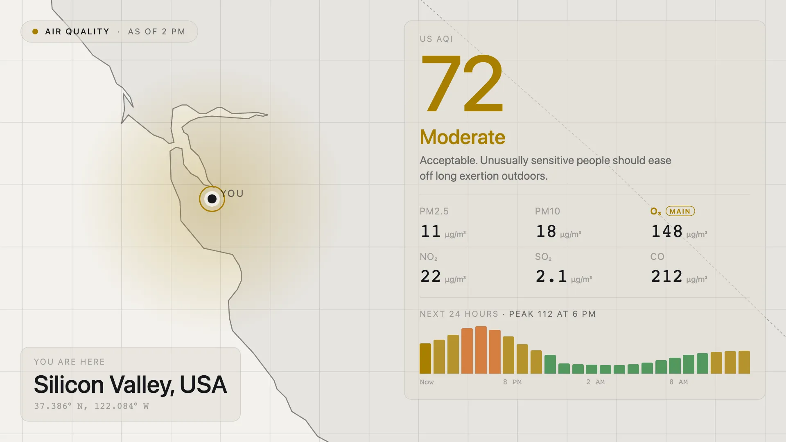

[](https://github.com/Screenly/air-quality-app/releases/latest)

# Air Quality: Screenly Edge App



The air quality index where the screen is, from
[Open-Meteo](https://open-meteo.com/en/docs/air-quality-api). It shows the
number, its category and what that means for people outside, coloured by band.
Below that are the six pollutants it is made of, with the one driving the
reading marked, and a bar for each of the next 24 hours. A map of the region
sits behind it, centred on the screen and washed in the colour of the reading.
Nothing animates. The reading refreshes every fifteen minutes, and Open-Meteo's
model updates hourly.

`aqi_scale` picks the index: **US AQI**, 0 to 500 from Good to Hazardous, or the
**European AQI**, 0 to 100 and over from Good to Extremely poor. The category
names, colours and advice follow the US EPA and the European Environment Agency.

A screen with no location set says so instead of guessing. Set
`override_coordinates` to a latitude and longitude, like `28.6139,77.2090`, to
read the air somewhere else. The heading then names the nearest city to that
point. `override_locale` changes how numbers and hours are written (`8.5` or
`8,5`, `7 PM` or `19 Uhr`). The labels stay in English.

## Open-Meteo licensing

Open-Meteo's free API is for **non-commercial use** only, and it needs no key.
Commercial deployments need a paid Open-Meteo plan. Put its key in
`open_meteo_api_key` and the app uses `customer-air-quality-api.open-meteo.com`
instead. The key is stored as a secret.

Open-Meteo sends `Access-Control-Allow-Origin: *`, so the app calls it directly
rather than through the CORS proxy.

## Behaviour when the API fails

This follows the Edge Apps failure-mode algorithm. The free API has no
credentials, and a rejected paid key is just another failed request, so only the
data half of that diagram applies:

| API    | `display_errors`   | Result                                           |
| ------ | ------------------ | ------------------------------------------------ |
| OK     | —                  | Cache the reading, show it                       |
| Failed | on                 | Show the error, draw nothing                     |
| Failed | off, cache present | Show the last reading, with its own "as of" hour |
| Failed | off, no cache      | Say it is unavailable                            |

The last row is the diagram's **Abort** terminal. `screenly.signalAbort()` does
not exist yet (Phorge T10903), so for now the app says what happened and signals
ready anyway. An app that never signals stalls the playlist for sixty seconds
and is then dropped with `PlaybackReason::LoadTimeout`.

A response with no index for this position, or an error body such as
`{"error":true,"reason":"..."}`, counts as a failure, not as a reading of zero.
The cache remembers the position and index it was taken for. It is ignored if
either has changed since.

The request is given 8 seconds. The screenshotter allows 10 seconds for the page
to go quiet and 10 more for the ready signal, so timing out early leaves room to
fall back to cache, draw, and signal inside the budget.

## Layout

The map is the same flat world as the Earthquake app, Natural Earth outlines
with the plate boundaries removed. State and province lines come from
`src/states.json` (`node scripts/generate-boundaries.mjs`, shared with the
OpenSky flight map), so an inland city such as Delhi is not a blank sheet of
land. It shows a window about 700 km across. On a landscape screen the readout
takes the right-hand side and the screen sits left of centre. On a portrait
screen the readout takes the top and the screen sits below it.

Every size on the page is a multiple of one unit: a hundredth of the screen's
width, or of its height scaled to 16:9, whichever is smaller. That way the layout
fills the screen whatever its shape. The library's stylesheet is deliberately not
imported. Its embedded Inter faces are 444 KB, and this app uses `system-ui`.

The bridge hands the coordinates over as strings. They are converted on the way
in, because `+` on a string silently poisons every sum downstream.

## Development

```bash
bun install
bun run dev
```

Mock screen data is in `mock-data.yml`. Edit it to move the screen somewhere
else.

```bash
bun run type-check   # also runs automatically before every build
bun run lint
bun run format
bun run test         # unit tests for the index, bands and parsing
bun run build && bun run verify   # every failure-mode branch, against dist/
bun run screenshots  # Playwright captures at each signage resolution
```

## Deployment

First time:

```bash
screenly edge-app create --name air-quality-app --in-place
bun run deploy
screenly edge-app instance create
```

Or run the **Initialize Edge App** GitHub Action for stage and production, then
set `STAGE_EDGE_APP_ID` / `PRODUCTION_EDGE_APP_ID`. Both need the
`SCREENLY_API_TOKEN` secret. After that, deploys go through **Update Edge App**,
which calls the reusable workflows in
[Screenly/edge-apps-actions](https://github.com/Screenly/edge-apps-actions)
(`v26.10.2`). Dependabot bumps that version.

### Releasing

Pushes to `main` start a stage deploy, which waits for approval. To release to
production, tag a commit on `main` using `vYY.M.PATCH` and push the tag (the
workflow refuses tags not on `main`); the production deploy also waits for
approval:

```bash
git checkout main && git pull
git tag v26.10.0
git push origin v26.10.0
```

Then publish a GitHub Release whose notes list the pull requests merged since
the previous release. Add `--draft` to review the notes before publishing:

```bash
gh release create v26.10.0 --verify-tag --generate-notes --title v26.10.0
```

- **GitHub Releases** hold the technical record for the tag: fixes, dependency
  updates, refactors. Engineering owns them.
- **CHANGELOG.md** holds the user-facing summary, in plain language. This is
  what the marketing site pulls. Marketing owns it.
